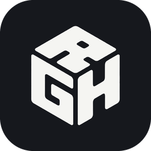
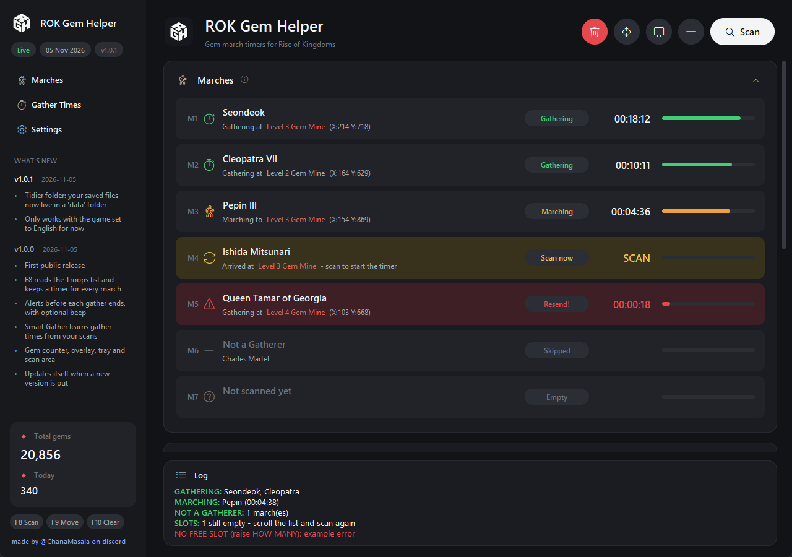

  

<h1 align="center">ROK Gem Notifier</h1>

Gem march timers for <b>Rise of Kingdoms</b> on PC

  <a href="https://github.com/Tim1501/rok-gem-notifier/releases/latest"><b>Download the latest version</b></a>

## What it does

When you farm gems by sending a march from one mine straight to the next, the
game never tells you when a gather is done. ROK Gem Notifier reads the Troops list
on your screen, keeps a timer for every march, and warns you shortly before each
gather ends, so you can send the march on right away.

- **Scan (F8)** reads every march, commander and Gem Mine level from the Troops list
- **Alerts** a Windows notification before each gather ends, with an optional beep
- **Overlay** small always-on-top timer window over the game
- **Smart Gather** learns how long each commander takes per Gem Mine level
- **Gem counter** gems farmed today and in total
- **Updates itself** when a new version is out, with one click

## Before you start

> **English only.** The app reads the text on your screen, so the game must be set
> to **English**. Other languages are not supported yet.

> **Antivirus / "Windows protected your PC" warning.** The app is free and not
> code-signed (signing costs money), so Windows SmartScreen and some antivirus
> programs warn about it or block it. This is common for small, unsigned apps.
> If you trust it, click **More info > Run anyway**; if your antivirus removed
> it, restore it from the antivirus quarantine (Windows Security > Protection
> history) and allow it. The full source code is in this repository.

## Install

1. Install **Tesseract OCR**, which reads the text on screen:
   [download it here](https://github.com/UB-Mannheim/tesseract/wiki) and keep the
   default install folder.
2. Download **ROK-Gem-Notifier.exe** from the
   [latest release](https://github.com/Tim1501/rok-gem-notifier/releases/latest)
   and put it in a folder of its own (for example `Documents\ROK Gem Notifier`).
3. Double-click it. Windows asks for administrator rights; that is needed for the
   F8 / F9 / F10 hotkeys to work while the game window is active.

The app saves everything (gems, gather times, settings) in a `data` folder next to
the exe. Keep the two together.

## How to use

1. **Settings > Marches**: choose how many marches you have.
2. Open the **Troops list** in the game and press **F8** (or click **Scan**).
3. Scan again after sending marches out, and once they start gathering.
4. When a row turns red (**Resend!**) the gather is about to end: send the march on.

Optional:
- **Settings > Scan area > Set**: drag a box around the Troops list for faster,
  more reliable scans.
- **Overlay** button: keeps the timers on top of the game.
- **Gather Times**: type how long each commander takes per Gem Mine level. A march's
  timer then starts by itself when it arrives at the mine.
- **Smart Gather**: learns those times from your scans (scan while a march is
  marching, then again once it gathers). While it is On the card shows
  **Smart Gather Times** (learned, read-only); turn it Off to see and edit your own.

| Default key | Action |
| --- | --- |
| F8  | Scan the Troops list |
| F9  | Unlock / lock the overlay to move it |
| F10 | Clear all timers |

Prefer other keys? **Settings > Hotkeys**: click Scan, Move or Clear and press the key
(or combination, like Ctrl+Shift+S) you want. The reset button brings back F8 / F9 / F10.

Gems are counted as Gem Mine level x 10 per finished gather (level 1 = 10 ...
level 4 = 40). Commander talents and buffs are not included.

## Updates

When a new version is published, the app shows **Update available** at the top.
Click **Update now**: it downloads the new version, checks it, and restarts.
Your saved data is kept. What changed is listed under **What's new** in the app
and on the [releases page](https://github.com/Tim1501/rok-gem-notifier/releases).

## Reporting a bug

1. In the app, click **Generate Bug Report** (bottom of the sidebar).
2. A zip file appears on your Desktop, for example
   `ROK Gem Notifier bug report 2026-11-05 1530.zip`. It contains the app's error log,
   your settings and timers, basic system info (Windows version, screen size), and
   the screenshot of your last failed scan, if there was one. Have a look at that
   screenshot before sending if you are worried about chat or names in it.
3. Send the zip to **@ChanaMasala** on Discord, with a short description: what you
   did, what you expected, and what happened. A screenshot of the app helps too.

## Repository layout

| Path | What it is |
| --- | --- |
| `source/rok_gem_notifier.py` | The whole app |
| `source/assets/` | Icon, logo and screenshot |
| `source/ROKGemNotifier.spec` | Build settings for the exe (PyInstaller) |
| `source/release.py` | Builds and publishes a new version |
| `donors.json` | The Top Donators list the app shows (edit it to add a donator) |

Run from source: `pip install mss pytesseract pillow opencv-python keyboard plyer pystray`,
then `python source/rok_gem_notifier.py`.

## A note from the developer

Hey, thanks for trying ROK Gem Notifier!

I make this app as a hobby, in my free time after my day job. That means bug fixes
and new features can sometimes take a while - thank you for your patience.

If the app helps you, please consider supporting it on PayPal:
**[paypal.me/DeepTak646](https://paypal.me/DeepTak646)** (or the **Donate** button in
the app). Any amount is greatly appreciated and really helps me keep working on it.

Everyone who donates (and wants to be named) is listed on the **Top Donators** board
in the app - just tell me on Discord which name to show.

Found a bug or have an idea? Message me on Discord: **@ChanaMasala**.

\- ChanaMasala

---

Not affiliated with Lilith Games.
